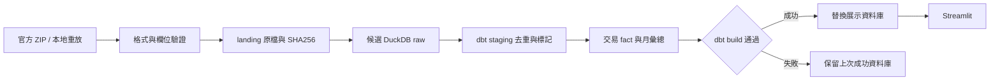

# 臺北實價登錄資料管線

把內政部買賣實價登錄季檔轉成可重跑、有品質檢查、可解釋的行政區房價分析。這是求職作品的本機 MVP，聚焦資料工程與分析工程：下載驗證、批次追蹤、版本去重、dbt 分層、品質閘門及 Streamlit 展示。

## 快速開始

本機環境統一使用 Python 3.12 與 uv；BigQuery 套件已加入，現有管線仍是 DuckDB 原型。GCP 登入與 BigQuery 最小連線驗證已完成，正式雲端模型尚未完成。完整環境說明見 [本機環境](docs/local_environment.md)。Windows PowerShell：

```powershell
cd E:\coding\taiwan-housing-pipeline
uv venv --python 3.12
uv pip sync requirements.lock --python .venv/Scripts/python.exe

# 先從官方頁面下載季檔，或使用現有 ZIP
.venv\Scripts\python.exe pipeline.py --zip C:\Users\User\Downloads\lvr_landcsv.zip --batch-id 114S4 --source-date 2025-12-10 --as-of 2026-11-15
.venv\Scripts\python.exe -m streamlit run app.py
```

此工作目錄已建好 `.venv`，不需重新建立。Linux/macOS 改用 `.venv/bin/python`，或啟用虛擬環境後使用 `python`。

`--min-date` 預設為 `2025-06-01`，用來重現原規劃文件的樣本；分析其他期間時請明確修改。`--as-of` 為判斷未來日期的基準，不指定時採執行機器的今天。季檔依登記期間收錄，並不等於交易季度，晚登記的交易可能很早。

`--source-date` 是來源快照的排序日期，不是本機載入日期。本包使用 `build_time.xml` 的買賣登記截止日 `2025-12-10`；這不是已驗證的發布日期。跨期、歷史回補及更正版需使用一致且可信的快照日期。相同日期時以 batch_id、來源列序決定保留版本。

## 架構與資料粒度



| 物件 | 一列代表什麼 | 規則 |
| --- | --- | --- |
| `raw.lvr_sale` | 某批次的原始 CSV 一列 | 分析所需欄位保持字串；附城市、來源日期、批次、列序、載入時間 |
| `stg_lvr_sale` | 一筆去重後買賣 | 以城市＋編號分組，來源日期最新者優先 |
| `fct_housing_deal` | 一筆符合分析條件的房地交易 | 日期、價格、面積有效，且未命中特殊交易規則 |
| `agg_district_month_price` | 一個城市、行政區、交易月 | 筆數及逐筆單價中位數 |
| `qa_exclusions` | 一個互斥排除原因 | 按固定優先順序歸類，可與 staging 對帳 |

目前只讀 `a_lvr_land_a.csv`（臺北買賣主表），原始完整 ZIP 保存在 `data/landing/<batch>/<sha256>/`。子表未 join，避免一對多造成總價重複。raw 同批次在交易內先刪後載，因此重跑不累加；不同批次的重複交易由 staging 處理。相同來源批次的新版 ZIP 會另存雜湊目錄。

## 清理規則與取捨

1. 僅納入 `房地(土地+建物)`、`房地(土地+建物)+車位`。
2. 備註包含完整用語 `親友、員工、共有人或其他特殊關係` 時排除。不能單憑有備註或出現「共有人」就排除。
3. 備註包含 `預售屋、或土地及建物分件登記` 時排除，避免舊簽約價混入。這是本作品分析口徑，不代表該類交易一定有錯。
4. 七位民國日期轉西元，無效日期、未來日期及早於分析起日者分別標記。
5. 扣車位後價格與面積必須大於零，車位價格及面積須為非負有效數字；空值不擅自當成 0。
6. 行政區不得空白。

每坪單價 = `(總價元 − 車位總價元) / (建物面積平方公尺 − 車位面積平方公尺) × 3.30579`。面積換坪則是除以 3.30579。這與直接使用官方單價欄乘常數是不同口徑；車位未拆價或填 0 時仍可能失真。沒有以任意價格門檻刪除離群值，也沒有把所有交易當成同質住宅。

備註採已知完整用語比對，未涵蓋所有可能的自由文字特殊交易。將來擴增規則前應抽樣覆核，避免誤判。跨月圖表從逐筆 fact 重新計算中位數，沒有平均月中位數。

## 驗證與 CI

2026-11-15 本機實跑：ZIP SHA256 `68315c006fa367834eaacf032ceccb22a114fc8798d87b8dac23cf5eb64030ab`，臺北原始 5,819 筆，去重後 5,819 筆，合格 2,658 筆，單價中位數 801,743 元／坪（80.2 萬）。依優先順序排除非房地 1,592 筆、特殊關係 502 筆、預售／分件登記 837 筆、早於起日 230 筆。4 個模型與 9 個 dbt tests 通過，6 個 pytest 案例通過；Streamlit 真實資料及清空月份選取也經 AppTest 驗證。原檔重跑後 raw 仍為 5,819 筆。

```powershell
.venv\Scripts\python.exe -m pytest -q
```

測試涵蓋 UTF-8 BOM／Big5、雙表頭、HTTP 200 HTML 假下載、缺少必要欄位、同批重跑、較舊批次回補、民國壞日期與未來日期、扣車位計算、一般備註保留，以及 dbt 失敗後展示資料庫不被更新。CI 使用明確標示的合成測試資料，不下載官方檔，也不需雲端金鑰。9 個 dbt tests 檢查唯一性、非空、正值、日期與筆數對帳、mart 非空。

`.github/workflows/ci.yml` 已準備；推到 GitHub 才會執行，目前未建立遠端 repository。`data/last_run.json` 記錄最近成功批次的 QA 數字，`analytics/target/run_results.json` 是 dbt 執行結果。失敗時程序回傳非零，可接排程告警。

## 官方下載模式

```powershell
.venv\Scripts\python.exe pipeline.py --season 114S4 --batch-id 114S4 --source-date 2025-12-10 --as-of 2026-11-15
```

先閱讀官方下載頁的授權及使用規範。下載器使用官方 `DownloadSeason` URL，每次逾時 60 秒，最多三次嘗試；檢查大小上限、ZIP 結構、CRC、manifest、build_time.xml、臺北主表及必要欄位。HTTP 200 不代表成功。

本次環境嘗試官方 GET 未取得可驗證的回應，已終止等待；因此「直接 GET 可成功下載」仍未驗證。已驗證的是本機官方格式 ZIP 的完整重放。若網站要求互動同意或下載器連不上，請用官方頁面手動下載後傳入 `--zip`，不繞過互動要求。

## 執行限制與下一階段

本機單一寫入程序使用，請勿同時執行多個 pipeline；Windows 若有其他程序持續開啟資料庫，替換可能被鎖住，關閉後重跑即可。Streamlit 每次查詢後關閉連線。展示庫以同一磁碟原子替換；JSON 報告另寫，兩者不是跨檔案交易。

目前未做遠端部署、通知、定時更新、刪除撤回案件同步或來源 SLA。最新批次未出現的舊交易不會自動刪除。更完整的當期更新需以來源撤回規則與定期全量重建補足。BigQuery 遷移也需調整 adapter、載入、日期與中位數語法、發布流程，不只有更換連線。

| WBS | 下一步 | 完成標準 |
| --- | --- | --- |
| 1 | 本機 MVP | 真實 ZIP 可載入，清理對帳，dbt 與 Python 測試通過，圖表可操作 |
| 2 | GitHub CI 與展示 | 遠端 CI 綠燈；他人依 README 重跑；選定公開展示方式 |
| 3 | 排程與回補 | 下載驗證後設定排程；三個來源期別回補，驗證順序不影響保留版本 |
| 4 | CDP 模擬 | 標示合成事件、建立使用者與區域／價格偏好分群，加入規則測試 |
| 5 | 選用雲端版 | BigQuery／Airflow 或 Dagster；成本與資料發布機制驗證 |

## 來源與授權

- 資料提供者：內政部地政司；[開放資料下載頁](https://plvr.land.moi.gov.tw/DownloadOpenData)。
- [非本期實價批次資料 18703](https://data.gov.tw/dataset/18703)：官方標示免費、政府資料開放授權條款第 1 版。
- [政府資料開放授權條款第 1 版](https://data.gov.tw/license)。本作品是清理與彙總後的衍生分析，不代表政府官方統計或樂屋網產品。
- [dbt-duckdb 原始碼與使用說明](https://github.com/duckdb/dbt-duckdb)、[Streamlit 文件](https://docs.streamlit.io/)。

原始資料、DuckDB、測試暫存及執行產物不納入 Git；合成測試列由程式產生。未宣稱樂屋網使用任何特定雲端或資料平台。
