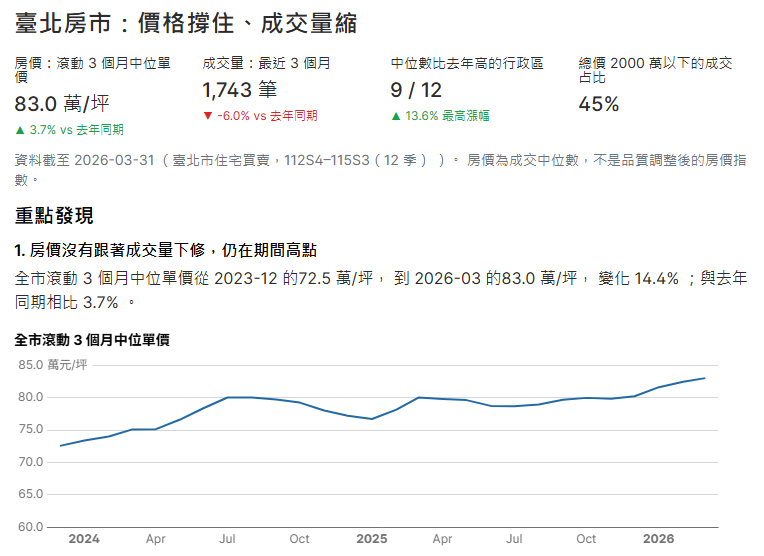
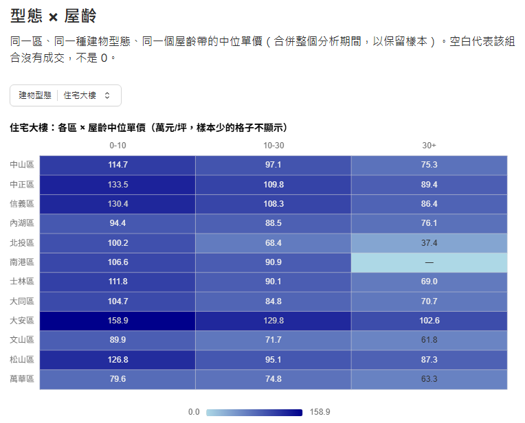
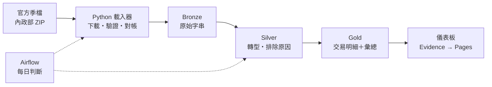

# 臺北實價登錄資料管線

把內政部公開的實價登錄季檔，自動整理成可信、可追溯的臺北房價分析，並每天發布成公開儀表板。

**[開啟儀表板](https://chengpeter88.github.io/taiwan-housing-pipeline/)**　·　資料：臺北市住宅買賣 2023-10 ～ 2026-03，共 23,716 筆

[](https://chengpeter88.github.io/taiwan-housing-pipeline/)

## 看到什麼

| | 發現 | 數字 |
| --- | --- | --- |
| 價格 | 房價沒有跟著成交量下修，仍在期間高點 | 全市滾動 3 個月中位單價 72.5 → 83.0 萬/坪（+14.4%） |
| 成交量 | 2024 年 9 月後明顯量縮，之後止穩 | 最近 12 個月平均每月 648 筆，前 12 個月 1,010 筆（−36%） |
| 產品 | 同一區，新大樓比老公寓貴很多 | 屋齡 10 年內大樓比 30 年以上公寓每坪貴 57–95% |
| 預算 | 同樣預算，選區決定能買多大 | 總價 1500–2000 萬：士林 29.1 坪、大安 14.2 坪 |

數字是成交中位數，不是品質調整後的房價指數；量縮與信用管制的時間相近，但沒有證明因果。完整說明與更多頁面見儀表板。

[](https://chengpeter88.github.io/taiwan-housing-pipeline/segments)

## 怎麼做的



| 步驟 | 做什麼 | 工具 |
| --- | --- | --- |
| 取得 | 從官方網站下載每季 ZIP，驗證格式、登記期間與 33 個欄位，再逐季載入 | Python 3.12、uv |
| Bronze | 每季一張表，保留官方原始字串，記錄來源檔的 sha256 與列序 | BigQuery |
| Silver | 轉換民國日期、金額、房數；每列標記一個排除原因，不刪任何資料 | dbt |
| Gold | 計算每坪單價、屋齡、預算帶；產生 5 張回答具體問題的彙總表 | dbt |
| 排程 | 每天判斷有沒有新季別、表是否快到期，需要才全量重跑 | Airflow 3（Docker） |
| 發布 | 查詢 Gold 彙總表，建置靜態網站並發布 | Evidence、GitHub Pages |

73,133 筆原始資料經 6 道規則篩出 30,756 筆合格房地交易，其中 23,716 筆為住宅。被排除的每一筆都有可查的原因，例如土地或車位單獨交易、親友間特殊關係、預售屋分件登記、車位無法拆算。規則與取捨見 [docs/staging.md](docs/staging.md)。

## 關鍵設計決策

| 限制或風險 | 決策 | 結果 |
| --- | --- | --- |
| 季別是「登記期間」，最新月份還沒登記完 | 分析截止日設在最後一季截止日前約 160 天的月底 | 最新月份筆數不會被低估；新季別進來時自動推進 |
| 備註是自由文字，「共有人」不一定是特殊交易 | 只比對官方完整用語，每列只給一個排除原因 | 排除可解釋、可對帳，不誤殺正常交易 |
| 中位數不能平均 | 跨月、跨區的數字一律從逐筆交易重新計算 | 滾動 3 個月中位數與獨立重算完全一致 |
| BigQuery 免費版的表 60 天到期，重新載入也不會延長 | 載入器先刪表再載；排程在到期前 14 天自動重跑 | 資料不會無聲消失 |
| 免費版儲存是終身 10 GiB，刪除也不退 | CI 一律建 view，只有正式層建 table | CI 每次執行幾乎不佔儲存 |
| repo 公開，不能放任何金鑰 | GitHub Actions 以 Workload Identity Federation 換 1 小時憑證；CI 與儀表板各用最小權限的帳號 | 0 把存放的金鑰；儀表板帳號只能讀 Gold、只限 main 分支 |

## 品質與自動化

- **234 項自動化檢查**：pytest 150 項（下載、驗證、排程判斷、CI 與儀表板設定）＋ dbt 84 項（11 組手算 unit test、唯一鍵、交叉對帳）。
- **獨立重算**：用 pandas 從 Silver 重算全部 Gold 彙總表，每一欄都與 dbt 結果一致；BigQuery 列數與官方 ZIP 逐季一致。
- **GitHub Actions**：每次 push 與 PR 跑 lint 和 pytest；改到 dbt 的 PR 在真實 BigQuery 上跑 dbt（只建 view、碰不到正式資料）；每天重建儀表板，任何查詢錯誤都不會發布。

細節見 [docs/quality.md](docs/quality.md)。

## 如何重現

需要：Python 3.12 與 [uv](https://docs.astral.sh/uv/)、一個 GCP 專案（BigQuery sandbox 即可）、以 `gcloud auth application-default login` 登入。GCP 專案 ID `taiwan-household` 目前直接寫在 dbt profiles、載入器、dbt source 與儀表板的設定中，用自己的專案重現時要全域取代。詳細步驟見 [docs/local_environment.md](docs/local_environment.md)。

```bash
uv venv --python 3.12
uv pip sync requirements.lock

# 1. 下載、驗證並載入一季到 BigQuery（Bronze）；全部季別列在 config/seasons.json
python -m scripts.load_bigquery --season 115S3
# 2. 建 Silver／Gold 並跑資料測試
dbt build --project-dir analytics_bigquery --profiles-dir analytics_bigquery
# 3. 檢查 BigQuery 實況：三層是否齊全、與官方檔對帳、剩餘天數
python -m scripts.verify_bigquery
# 4. 與 CI 相同的測試與 lint
pytest -q && ruff check . && black --check .
```

Windows 先執行 `.venv\Scripts\Activate.ps1`，macOS／Linux 執行 `source .venv/bin/activate`。每日排程見 [docs/airflow.md](docs/airflow.md)，儀表板本機開發見 [docs/dashboard.md](docs/dashboard.md)。

## 專案結構

```text
config/              季別清單與分析期間（唯一的設定來源）、欄位對應
scripts/             官方下載與載入器、排程判斷、BigQuery 驗證
analytics_bigquery/  dbt 專案：Silver 與 Gold 模型、unit test、資料測試
orchestration/       Airflow DAG 與 Docker Compose
dashboard/           Evidence 儀表板（SQL ＋ Markdown）
infra/               GCP Workload Identity Federation 一次性設定腳本
tests/               pytest
.github/workflows/   CI、dbt CI、儀表板發布
```

| 文件 | 內容 |
| --- | --- |
| [raw_loading.md](docs/raw_loading.md) | 官方下載、驗證、每季一表、表到期與重建 |
| [staging.md](docs/staging.md) | 分析期間的依據、排除規則與取捨 |
| [marts.md](docs/marts.md) | Gold 交易明細與彙總表的口徑、樣本門檻 |
| [airflow.md](docs/airflow.md) | 每日判斷規則、DAG 流程、重試策略、Docker 啟動 |
| [quality.md](docs/quality.md) | 驗證結果與 GitHub Actions |
| [ci_dbt.md](docs/ci_dbt.md) | CI 以 WIF 跑 dbt：權限設計、一次性設定 |
| [dashboard.md](docs/dashboard.md) | 儀表板頁面、公開資料範圍、唯讀權限、一次性設定 |

## 限制與下一步

- **排程跑在本機 Docker**：電腦關機時不會執行；下一步是遷到雲端排程並加上失敗通知。
- **只有成交中位數**：無法區分真漲價與成交組合變化；下一步是建立品質調整指數（控制屋齡、坪數、型態、樓層）。
- **只有臺北、只有主表**：建物、土地、車位子表未 join，避免一對多造成總價重複；下一步是參數化擴充其他縣市。
- **儀表板使用 Evidence 40.1.8**：npm 版已停止更新，目前鎖定版本使用。

## 資料來源與授權

- 資料提供者：內政部地政司，[不動產成交案件實際資訊](https://plvr.land.moi.gov.tw/DownloadOpenData)（[資料集 18703](https://data.gov.tw/dataset/18703)）。
- 依 [政府資料開放授權條款第 1 版](https://data.gov.tw/license) 使用。本專案是清理與彙總後的衍生分析，不代表政府官方統計。
- 原始資料、測試暫存與執行產物不納入 Git；測試資料由程式產生。
