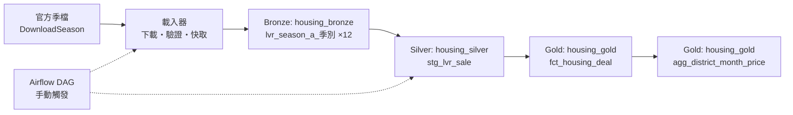

# 臺北實價登錄資料管線

把內政部買賣實價登錄季檔轉成可重跑、有品質檢查、可解釋的行政區房價分析。這是求職作品，聚焦資料工程與分析工程：官方下載與驗證、BigQuery 載入、dbt 分層與測試、Airflow 排程。

目前範圍：台北市買賣，112S4–115S3 共 12 季（73,133 列），分析期間 2023-10-01 ~ 2026-03-31。季別與分析期間只在 [config/seasons.json](config/seasons.json) 設定一次。

## 架構



BigQuery 採 medallion 三層，每層一個 dataset：

| 層 | 物件 | 一列代表什麼 | 說明 |
| --- | --- | --- | --- |
| Bronze | `housing_bronze.lvr_season_a_<季>` | 官方 CSV 的一列 | Python 載入器寫入；33 個原始欄位皆為字串，加上季別、來源 sha256、列序、載入時間 |
| Silver | `housing_silver.stg_lvr_sale` | 來源的一列 | dbt；只做型別轉換（日期、金額、房數、電梯等）、旗標、唯一的 `exclusion_reason` |
| Gold | `housing_gold.fct_housing_deal` | 一筆合格房地交易 | dbt；各用途皆保留，加上屋齡、屋齡帶、坪數帶、預算帶、建物分組 |
| Gold | `agg_district_month_price` | 城市 × 行政區 × 月 | 各區每月住宅中位單價 |
| Gold | `agg_district_quarter_price` | 城市 × 行政區 × 季 | 哪一區在漲：P25／中位數／P75、年增率 |
| Gold | `agg_district_segment_price` | 城市 × 行政區 × 建物型態 × 屋齡帶 | 新大樓與老公寓差多少 |
| Gold | `agg_district_budget` | 城市 × 行政區 × 總價帶（近 12 個月） | 某個預算能買到幾坪、屋齡多少 |
| Gold | `agg_city_month_market` | 城市 × 月 | 市場冷熱：成交量、滾動 3 個月中位數 |

Gold 的口徑、樣本門檻與目前的分析結果見 [docs/marts.md](docs/marts.md)。

dbt 的 dataset 名稱由 [generate_schema_name](analytics_bigquery/macros/generate_schema_name.sql) 決定：target 為 `prod` 時寫入 `housing_silver`、`housing_gold`；其他 target（例如 CI）自動加前綴（`ci_housing_gold`），不會覆蓋正式資料。

## 快速開始

Python 3.12，以 uv 管理依賴。環境、GCP 登入與重建方式見 [本機環境](docs/local_environment.md)。

```powershell
cd E:\coding\taiwan-housing-pipeline
uv venv --python 3.12
uv pip sync requirements.lock --python .venv/Scripts/python.exe

# 逐季下載、驗證並載入 BigQuery（也可交給 Airflow DAG）
.venv\Scripts\python.exe -m scripts.load_bigquery --season 115S3
# 建模與資料測試
.venv\Scripts\dbt.exe build --project-dir analytics_bigquery --profiles-dir analytics_bigquery
# Python 測試、lint 與格式檢查（與 CI 相同）
.venv\Scripts\python.exe -m pytest -q
.venv\Scripts\ruff.exe check .
.venv\Scripts\black.exe --check .
```

Linux／macOS 改用 `.venv/bin/python`。

| 文件 | 內容 |
| --- | --- |
| [docs/raw_loading.md](docs/raw_loading.md) | 官方下載、驗證、每季一表、sandbox 到期與重建 |
| [docs/staging.md](docs/staging.md) | 分析期間的依據、排除規則、unit tests |
| [docs/marts.md](docs/marts.md) | 交易明細與行政區月中位數、驗證結果 |
| [docs/airflow.md](docs/airflow.md) | DAG 流程、重試策略、Docker 啟動與驗收紀錄 |
| [docs/dataset_review.md](docs/dataset_review.md) | 單季資料盤點（清理規則的推導依據，歷史紀錄） |

## 清理規則與取捨

1. 僅納入 `房地(土地+建物)`、`房地(土地+建物)+車位`。
2. 備註包含完整用語 `親友、員工、共有人或其他特殊關係` 時排除。不能單憑有備註或出現「共有人」就排除。
3. 備註包含 `預售屋、或土地及建物分件登記` 時排除，避免舊簽約價混入。這是本作品的分析口徑，不代表該類交易一定有錯。
4. 民國日期（6 或 7 位數）轉西元；無效日期、晚於截止日、早於起日分別標記。
5. 車位必須可拆算：無車位交易的車位價格與面積皆為 0，含車位交易的車位價格與面積皆大於 0；其他情形排除。
6. 扣車位後價格與面積必須大於零；空值不擅自當成 0。行政區不得空白。
7. 同一編號在納入的季別中重複出現時暫停納入，不自行挑一筆。

每坪單價 = `(總價元 − 車位總價元) / (建物面積平方公尺 − 車位面積平方公尺) × 3.30579`。這與直接使用官方單價欄乘常數是不同口徑。沒有以任意價格門檻刪除離群值，也沒有把所有交易當成同質住宅。

備註採已知完整用語比對，未涵蓋所有自由文字的特殊交易（例如「瑕疵物件」仍會納入）。跨月分析要從逐筆 fact 重新計算中位數，不可平均月中位數。

## 驗證與 CI

2026-11-17 驗證結果：

- pytest 68 項通過：季別解析、官方下載（含未發布季別回 HTML、超過上限）、快取、12 季真實 `build_time.xml` 的登記期間、ZIP 與欄位驗證、載入與列數核對、dataset 自動建立、CLI exit code、設定與分層一致性。
- `dbt build` 78 項通過（7 個模型）：11 組 unit tests 以手算的小資料覆蓋 12 種排除原因、6 位數日期、屋齡週年邊界、分組邊界、精確分位數、年增率、滾動中位數與 NULL 處理；其餘資料測試涵蓋唯一鍵、允許值、季別完整性、各表與 fact 及月表的交叉對帳、價格公式與分位數順序。
- BigQuery 12 張季表的列數與官方 ZIP 逐季一致；pandas 從 Silver 獨立重算 fact 衍生欄位與全部 Gold 彙總表，每一欄都完全一致。
- Airflow 3.4.0 容器：12 季全量執行成功、同參數重跑筆數不變、未發布與格式錯誤的季別在對應任務失敗且不重試。

`.github/workflows/ci.yml` 在 push 到 main 與每個 PR 時依序執行 `ruff check`、`black --check` 與 pytest，不下載官方檔，也不需要雲端金鑰。格式與 lint 設定在 `pyproject.toml`（行寬 100、保留單引號）。dbt 需要 BigQuery 連線，目前只在本機與 Airflow 執行。

## 限制與下一步

- BigQuery sandbox 的表在 60 天後自動刪除，重建方式見 [raw_loading.md](docs/raw_loading.md)。
- dbt 直接更新 `housing_gold`，尚未有展示版本切換與回復機制。
- Airflow 只接受手動觸發；尚未做遠端部署、通知或來源撤回案件同步。
- 目前只有台北買賣主表，子表未 join，避免一對多造成總價重複。

| 下一步 | 完成標準 |
| --- | --- |
| CI 執行 dbt | GitHub Actions 以 Workload Identity Federation 連 BigQuery，PR 時跑 dbt build |
| 展示 | Looker Studio 或其他展示層讀取 marts，標明分析口徑與限制 |
| 自動排程 | 新季別發布後自動載入；加入發布閘門與失敗通知 |
| 擴充範圍 | 其他縣市；評估是否納入子表 |

## 來源與授權

- 資料提供者：內政部地政司；[開放資料下載頁](https://plvr.land.moi.gov.tw/DownloadOpenData)。
- [非本期實價批次資料 18703](https://data.gov.tw/dataset/18703)：官方標示免費、政府資料開放授權條款第 1 版。
- [政府資料開放授權條款第 1 版](https://data.gov.tw/license)。本作品是清理與彙總後的衍生分析，不代表政府官方統計或樂屋網產品。

原始資料、測試暫存及執行產物不納入 Git；測試資料由程式產生。未宣稱樂屋網使用任何特定雲端或資料平台。
